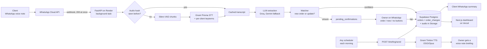

# Recall

A factory's clients send WhatsApp voice notes in Hinglish. Recall turns them into an order book that keeps itself up to date.

Built for Gnani AI's Great Indian AI Internship Challenge, on Prisma (speech to text) and Timbre (text to speech).

## The problem

In small factories and MSMEs, most orders are placed over the phone or on WhatsApp, and almost none of it gets written down. In a two minute call, a client places an order, raises the quantity, pushes the rate down and fixes a delivery date. A week later nobody is sure what was agreed.

This leads to:

- Missed or late deliveries, because a date was never noted
- Wrong bills, because a rate change was forgotten
- Disputes where it is the owner's word against the client's
- The owner keeping the whole order book in their head

The tools that exist today don't fit. Call recorders give hours of audio that nobody listens to again. Order and ERP apps need someone to type everything in, and on a busy shop floor nobody does.

Recall lets clients keep ordering the way they already do. The owner doesn't type anything.

## How it works

A client sends a voice note like this one:

> "Bhaiya wo 200 bracket wala order hai na, usko 300 kar do. Aur ek naya chahiye, 3mm MS sheet ke 50 piece, Friday tak."

1. **WhatsApp.** The note reaches Recall's WhatsApp number. The webhook checks Meta's signature, returns 200 right away and does the rest in a background task, so slow steps never block WhatsApp.
2. **Cache check.** We hash the audio (SHA-256). If we have already transcribed this file, we reuse the transcript and spend no credits.
3. **Prisma STT with per-client keyterms.** Silero VAD splits the note into chunks of up to 30 seconds, and each chunk goes to Prisma REST. We send keyterms built for the sender: client name, aliases and the items and specs of their open orders (for example `Sharma Steels`, `bracket`, `MS sheet`). Each chunk's start and end time is kept, so we know where in the audio each sentence was said.
4. **LLM extraction.** The LLM turns the transcript into a list of items: new order or update, item, spec, quantity, unit, rate, delivery date, and the exact words the client used as evidence. Code then checks that the evidence really appears in the transcript and turns phrases like "Friday tak" into a real date (IST). If the evidence isn't found, the item's confidence is lowered.
5. **Matcher.** For each item, the matcher decides between a new order and an update to an open order, and which one. An update is applied only if there is exactly one candidate order, confidence is at least 0.7, and the order's item name was actually said.
6. **Order book or owner confirmation.** Confident items are saved to `orders`, and an `order_changes` row is written in the same transaction, linked to the call and the audio clip where it was said. Anything unsure goes to `pending_confirmations`. The owner then gets a WhatsApp message with buttons (for example "Brackets 200 to 300: order #12 or #15?"), and nothing is saved until they tap. The client gets a short WhatsApp summary of what was recorded.
7. **Dashboard.** Shows deliveries due today and tomorrow, open orders, each order's change history with a playable audio clip for every change, recent calls with transcripts, and pending confirmations.
8. **Morning briefing.** The briefing is triggered with `POST /briefing/send`, so any scheduler can call it each morning. Recall writes a short Hinglish summary of today's and tomorrow's deliveries and pending items, Timbre turns it into an OGG/Opus voice note, and it is sent to the owner on WhatsApp.

Rules the code follows:

- It never guesses silently. Low confidence or an ambiguous match always goes to the owner.
- `orders` is never changed without a matching `order_changes` row, so the history is complete.
- Outbound WhatsApp messages have a hard daily cap (`WA_DAILY_SEND_CAP`).
- All demo data is synthetic. No real customer data.

## Architecture



## Where each Gnani model is used

| Model | Where | What it does |
| --- | --- | --- |
| Prisma v3.0 (STT) | `backend/app/stt.py` | Transcribes every voice note. REST endpoint, one VAD chunk (30 s max) at a time, `language_code=hi-IN,en-IN`, `format=codemix` (Hindi in Devanagari, English in Latin script). Per-client `keyterms` and `previous_text` from the last chunk keep context across chunks. |
| Timbre v2.5 (TTS) | `backend/app/tts.py`, `backend/app/briefing.py` | Reads the morning briefing aloud in a Hinglish voice (Poorvi). Outputs OGG/Opus, which WhatsApp plays as a normal voice note. Also used to voice the synthetic eval set (`eval/make_audio.py`). |
| Evon (LLM) | Not in this build | Planned for a nightly summary on Kaggle's free GPUs. Live extraction and matching run on Groq, with Gemini Flash-Lite as fallback, through one client (`backend/app/llm.py`). |

## Finding: per-client keyterms fix the words that matter

We transcribed the same sample voice note twice with Prisma v3.0, once with keyterms for the sender and once without. Both transcripts are real Prisma output, saved in `backend/tests/fixtures/`.

| | Without keyterms | With keyterms |
| --- | --- | --- |
| Client name | शर्मा steel | **Sharma Steels** |
| The order being updated | दो सौ **रुपए का डाला** order | दो सौ **bracket वाला** order |
| Everything else | same | same |

Full text:

- Without keyterms (`transcript_no_keyterms.txt`): *हाँ भैया, शर्मा steel से बोल रहा हूँ। वो दो सौ रुपए का डाला order है ना, उसको three hundred कर दो ...*
- With keyterms (`transcript_keyterms.txt`): *हाँ भैया, Sharma Steels से बोल रहा हूँ। वो दो सौ bracket वाला order है ना, उसको three hundred कर दो ...*

Only two phrases differ, but they are the two that matter most for the order book:

- Without keyterms, the word "bracket" is lost and "200" becomes "200 rupees". The update now has no item, and it looks like a rate instead of a quantity. The matcher only applies an update if the order's item name was said, so this would end up as an owner question instead of an update.
- The client's name comes out in its exact registered form, which makes the client easy to match by name.

The rest of the note (numbers, "3 mm MS sheet", "fifty piece", "Friday") is the same in both. So keyterms don't change the whole transcript, they fix the domain words a general model has no reason to know. Since every client orders a small set of items, we build the keyterm list per sender from their name, aliases and open orders (`stt.client_keyterms`), within Prisma's limit of 200.

## Evaluation

The test set is 10 synthetic Hinglish voice notes (`eval/cases.json`) that cover: a new order, quantity, rate and date changes, two items in one note, an ambiguous update (a client with two open MS sheet orders) and a noisy note at 3 dB SNR. Each script is voiced with two Timbre Hinglish voices. A second copy of each is mixed with noise (10 dB SNR, 3 dB for the noisy case) and squeezed to 8 kHz phone quality with ffmpeg. Both copies run through the real backend code. See `eval/README.md` for how each metric is computed.

| Metric | Clean audio | Noisy 8 kHz audio |
| --- | --- | --- |
| WER | 12.1% | 11.8% |
| CER | 10.0% | 8.2% |
| Extraction accuracy (item, quantity, rate, date all right) | 10/12 (83%) | 10/12 (83%) |
| Matching accuracy | 9/12 (75%) | 11/12 (92%) |
| Confirmation rate (items sent to the owner) | 4/12 (33%) | 2/12 (17%) |
| Latency: Prisma, median / max | 0.6 s / 0.8 s | 0.5 s / 0.9 s |
| Latency: extract + match, median / max | 3.3 s / 9.0 s | 3.7 s / 7.2 s |
| Latency: total (no DB writes), median / max | 3.8 s / 9.6 s | 4.2 s / 7.8 s |

Live LLM: Groq gpt-oss-120b with Gemini Flash-Lite fallback.

10 notes is a small set; numbers vary by about ±1 item between runs due to LLM variance.

In both runs, no item was saved to the wrong order. Every miss was either a wrong value (misheard in the transcript or misread by the LLM) or a low-confidence item sent to the owner.

Numbers come from `eval/results.md`.

## Tech stack (all free tier, no credit card)

| Layer | Choice |
| --- | --- |
| Messaging | WhatsApp Cloud API (Meta test number) |
| Speech | Gnani Prisma (STT) and Timbre (TTS) |
| LLM | Groq, Gemini Flash-Lite as fallback |
| Backend | Python, FastAPI on Render |
| Database and audio | Supabase Postgres and Storage |
| Dashboard | Next.js and Tailwind on Vercel (Hobby) |
| Scheduler | GitHub Actions cron, daily Supabase keepalive only (`.github/workflows/keepalive.yml`). The briefing is a plain `POST /briefing/send` that any scheduler can call |
| Audio tools | ffmpeg, Silero VAD (run locally) |
| Python tooling | uv, pytest |

## How to run

You need Python 3.12+, [uv](https://docs.astral.sh/uv/), Node.js, ffmpeg, and free accounts for Gnani, Meta (WhatsApp Cloud API test number), Groq, Google AI Studio (Gemini) and Supabase.

**ffmpeg is required by the backend.** It runs `ffmpeg` and `ffprobe` on every voice note (converting audio for Silero VAD and cutting proof clips), so both must be on `PATH` wherever the backend runs. The demo runs the backend locally behind ngrok.

**1. Config.** Copy the example env file and fill it in. Set `CRON_SECRET` to any random string (used by `/briefing/send`).

```bash
cp .env.example .env
```

**2. Database.** Run the files in `supabase/migrations/` in order in the Supabase SQL editor, and create a private Storage bucket named `audio`. Then add the synthetic demo clients and orders:

```bash
cd backend && uv run python -m scripts.seed
```

**3. Backend.**

```bash
cd backend
uv run uvicorn app.main:app --reload     # http://localhost:8000
uv run pytest                            # all external APIs mocked, no credits used
```

**4. WhatsApp webhook.** Expose the backend with `ngrok http 8000` (or cloudflared). In the Meta app dashboard, set the callback URL to `https://<your-tunnel>/webhook` and the verify token to `WA_VERIFY_TOKEN`. Send a voice note to the test number from a verified phone.

To try the pipeline without WhatsApp:

```bash
cd backend && uv run python -m scripts.run_pipeline path/to/note.ogg --phone 919800000001
```

**5. Dashboard.**

```bash
cd dashboard
cp .env.local.example .env.local         # SUPABASE_URL, SUPABASE_SERVICE_KEY
npm install
npm run dev                              # http://localhost:3000
```

**6. Morning briefing.**

```bash
curl -X POST http://localhost:8000/briefing/send -H "Authorization: Bearer $CRON_SECRET"
```

The repo doesn't schedule this. Point any scheduler (cron, a GitHub Actions workflow, cron-job.org) at it each morning.

**Supabase keepalive.** Free Supabase projects pause after a week idle. `.github/workflows/keepalive.yml` runs one small select a day. Add `SUPABASE_URL` and `SUPABASE_SERVICE_KEY` as repo secrets in GitHub.

**7. Evaluation.** Asks before spending any credits. Transcripts are cached, so re-runs are free.

```bash
uv run --project backend python eval/make_audio.py
uv run --project backend --with jiwer python eval/run_eval.py
```

## Repo layout

```
backend/               FastAPI app: webhook, STT, extraction, matcher, pipeline, briefing
dashboard/             Next.js order book
supabase/migrations/   SQL schema
eval/                  Synthetic voice notes, noise mixing, scoring
docs/                  PRD, Gnani API notes, demo script
.github/workflows/     daily Supabase keepalive
```

## Team

Akshat Patil and Famous Raj Bhat.
